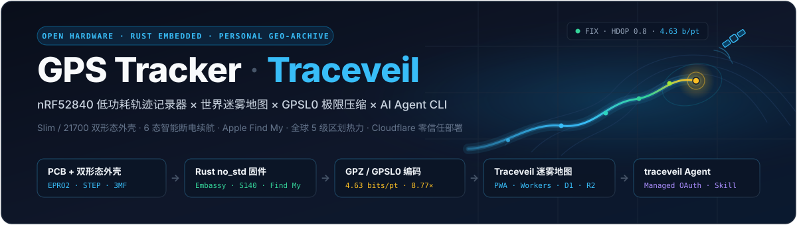
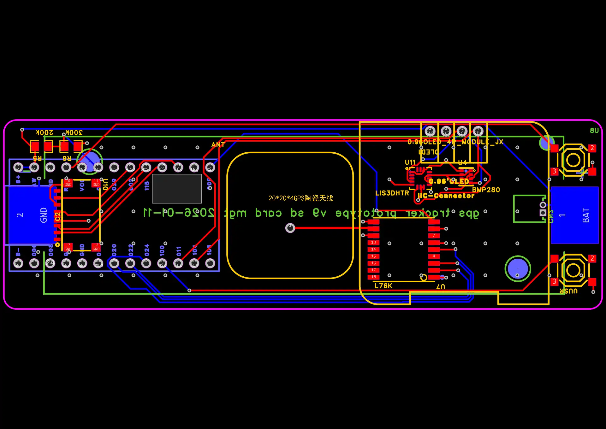
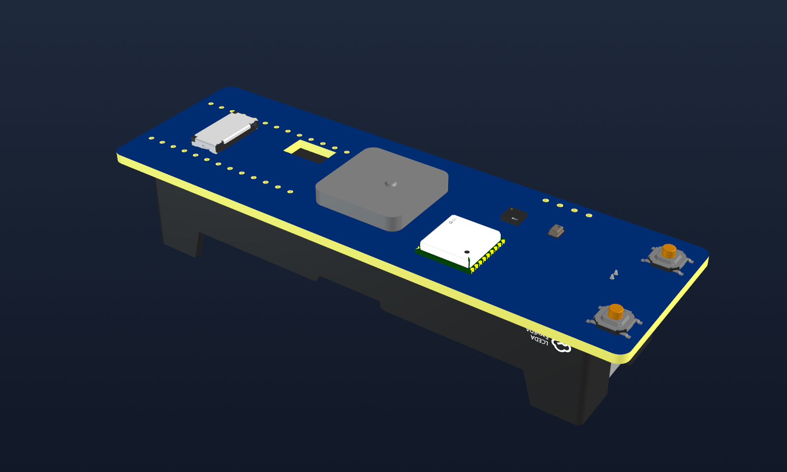
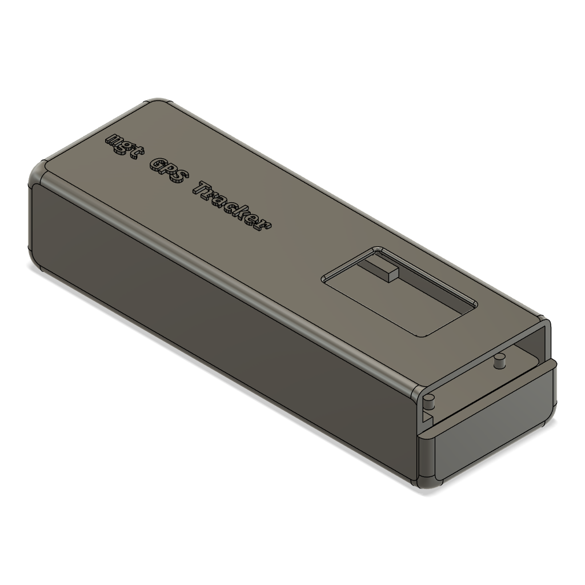
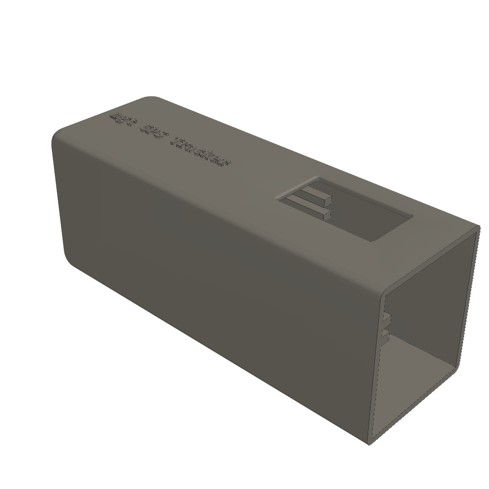
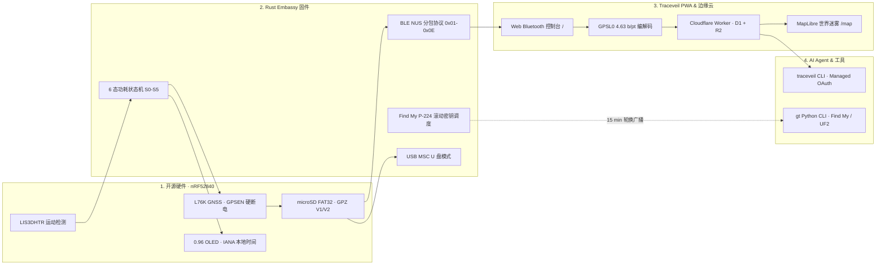
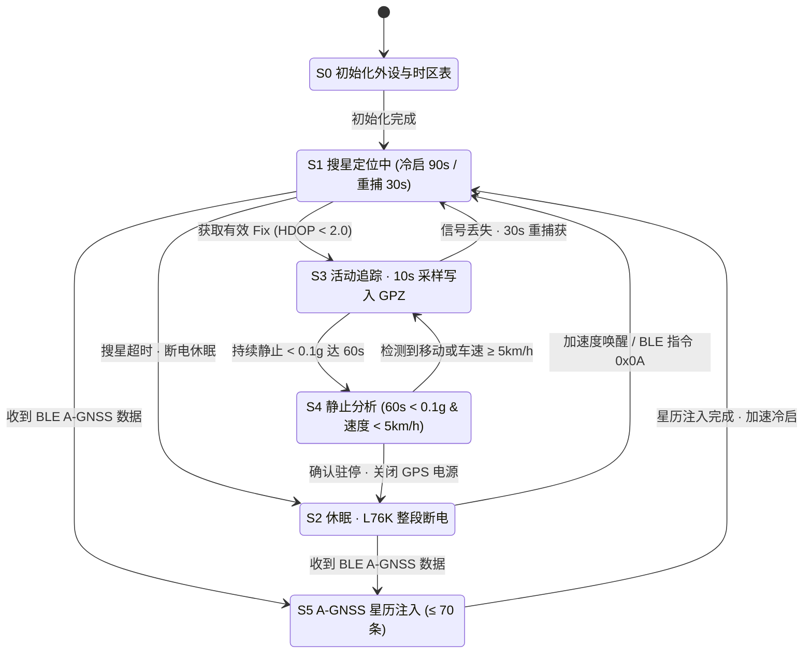
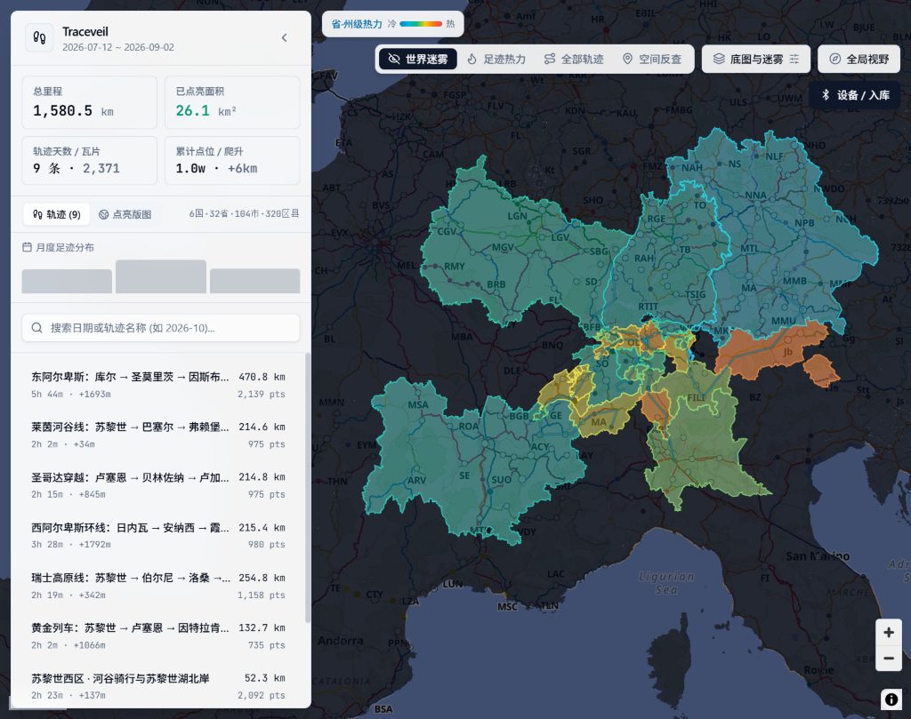
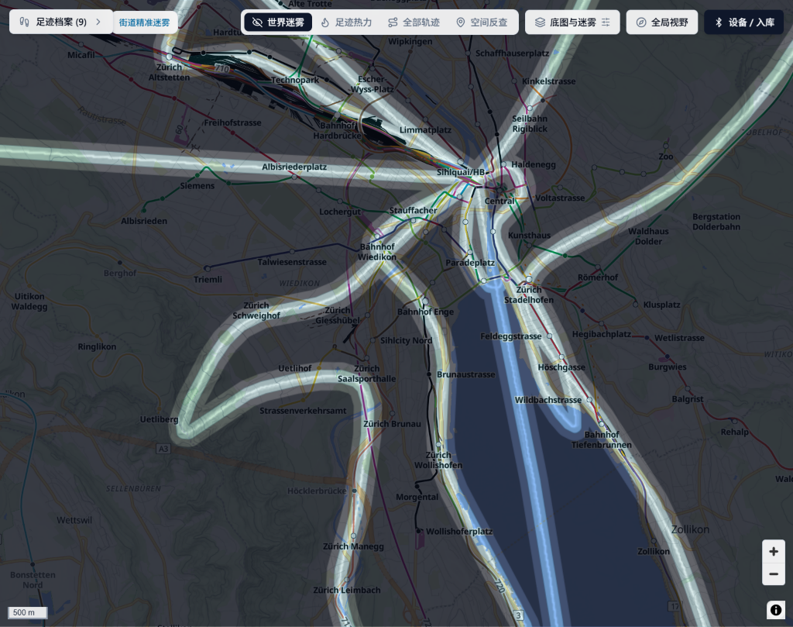

<div align="center">



<h3>从零开源的 nRF52840 低功耗 GPS 记录器 × Traceveil 世界迷雾地图 × AI Agent 足迹档案</h3>

<p>
  <strong>PCB 源工程 &amp; 3D STEP + 双形态 3D 打印外壳</strong> ·
  <strong>Rust <code>no_std</code> 异步固件</strong> ·
  <strong>Apple Find My 防丢</strong> ·
  <strong>GPSL0 4.63 bits/pt 压缩</strong> ·
  <strong>Cloudflare Workers 迷雾地图</strong> ·
  <strong>Agent CLI</strong>
</p>

<p>
  <a href="https://github.com/Enter-tainer/gps_tracker/actions/workflows/build-firmware-uf2.yml"></a>
  <a href="https://github.com/Enter-tainer/gps_tracker/actions/workflows/deploy-frontend.yml"></a>
  <a href="hardware/README.md"></a>
  <a href="firmware/"></a>
  <a href="docs/gpsl0_impl_report.md"></a>
  <a href="docs/deploy_cloudflare.md"></a>
  <a href="cli/"></a>
</p>

<p>
  <a href="LICENSE"></a>
  <a href="hardware/LICENSE-CERN-OHL-S-2.0.txt"></a>
  <a href="hardware/LICENSE-CC-BY-4.0.txt"></a>
</p>

<p>
  <a href="#核心能力一览">核心能力</a> ·
  <a href="#硬件与双形态外壳">硬件与双外壳</a> ·
  <a href="#全栈架构与状态机">全栈架构</a> ·
  <a href="#gpsl0-信息论级轨迹压缩">GPSL0 压缩</a> ·
  <a href="#traceveil-迷雾地图与私有云">迷雾地图</a> ·
  <a href="#ai-agent-cli-与-skill">AI Agent CLI</a> ·
  <a href="#快速开始">快速开始</a> ·
  <a href="#english">English</a>
</p>

</div>

---

> **一句话定位**：把这枚巴掌大的开源追踪器丢进背包或车里，它会通过加速度计感知运动，**静止时自动给 GNSS 模块整段硬断电、移动时唤醒高精度采样**；回家后用浏览器通过 **Web Bluetooth** 直连导入轨迹，在个人 **Traceveil** 私有云上解锁全球 5 级行政区划与街道「世界迷雾」，还能直接让 AI Agent 用自然语言检索你去过的每一个角落。

---

## 核心能力一览

<table>
  <tr>
    <td width="50%" valign="top">
      <h3>🛠️ 完整开源硬件 · Slim / 21700 双形态</h3>
      <ul>
        <li><strong>95 × 30 mm 双层板</strong>：ProMicro nRF52840 + Quectel L76K + 25 mm 陶瓷天线 + LIS3DHTR + BMP280 + 0.96" OLED + microSD，共 13 项精选 BOM。</li>
        <li><strong>两种可打印外壳</strong>：<strong>Slim 轻薄版</strong>配背面软包薄锂电（接 <code>CN2</code>），<strong>21700 续航版</strong>配板载 <code>U8</code> 电池座装单节 21700 大电芯。</li>
        <li><strong>工程源文件全公开</strong>：立创 EDA Pro 可编辑源工程（<code>.epro2</code>）、AP214 彩色 3D STEP 模型与两套外壳 <code>.3mf</code> / <code>.stl</code>。</li>
      </ul>
    </td>
    <td width="50%" valign="top">
      <h3>🦀 纯 Rust <code>no_std</code> 异步固件</h3>
      <ul>
        <li><strong>6 态智能功耗状态机</strong>：静止 60 s 后彻底切断 L76K 供电（<code>GPSEN</code> 拉低），周级别便携续航；支持 A-GNSS 星历注入冷启加速。</li>
        <li><strong>Apple Find My 离线查找</strong>：默认启用 P-224 ANSI X9.63 15 分钟滚动密钥广播，通过优先级调度器与主 BLE 轮替，丢失可借全球 iPhone 网络回溯。</li>
        <li><strong>三模极简交互</strong>：短按切屏、长按快广播刷盘、超长按秒变 USB U 盘直读 TF 卡；内置离线 IANA 时区库，OLED 直接显示本地时间。</li>
      </ul>
    </td>
  </tr>
  <tr>
    <td width="50%" valign="top">
      <h3>🗺️ Traceveil 世界迷雾 &amp; GPSL0 极限压缩</h3>
      <ul>
        <li><strong>4 大空间视图</strong>：世界迷雾（Z15/Z21 街道擦除）、足迹热力、全部轨迹、点/框选空间反查，叠加 OpenRailwayMap 铁路与 Mapterhorn 3D 地形。</li>
        <li><strong>全球 5 级区划 LOD</strong>：缩放自适应切换「国家 → 省/州 → 地市 → 区县 → 街道」，Worker 端动态切片 MVT 矢量瓦片。</li>
        <li><strong>GPSL0 无损压缩</strong>：面向归档的二阶运动学预测 + 11-bit Range Coder，在 202 万真实点上压至 <strong>4.63 bits/pt</strong>（比 GPZ 小 <strong>8.77×</strong>，比 GPX 小 <strong>~220×</strong>）。</li>
      </ul>
    </td>
    <td width="50%" valign="top">
      <h3>🤖 Cloudflare 私有云 &amp; AI Agent CLI</h3>
      <ul>
        <li><strong>单 Worker 一体化云端</strong>：SPA 控制台 + <code>/api/*</code> + D1 空间索引与轨迹块 + R2 全球迷雾位图，开箱接入 Cloudflare Access 零信任鉴权。</li>
        <li><strong><code>traceveil</code> Agent CLI</strong>：基于 Cloudflare Access Managed OAuth（PKCE + 自动刷新，零 Bypass 规则），支持远端 <code>--manual</code> 授权。</li>
        <li><strong>内置 Agent Skill</strong>：直接配合 <code>skills/traceveil/SKILL.md</code>，支持行程停靠分析、GCJ-02/WGS-84 坐标反查与时间定位。</li>
      </ul>
    </td>
  </tr>
</table>

---

## 硬件与双形态外壳

一套 PCB 兼容**轻薄便携**与**超长续航**两种装机形态——只需在焊接电池接口（`CN2` vs `U8`）时二选一，再打印对应的外壳即可。

<div align="center">
<table>
  <tr>
    <td align="center" width="50%">
      <br />
      <sub><strong>2 层 PCB 布局（EasyEDA Pro）</strong> · 95.0 × 30.0 mm · 13 项物料</sub>
    </td>
    <td align="center" width="50%">
      <br />
      <sub><strong>3D PCB STEP 装配渲染</strong> · <a href="hardware/pcb/gps-tracker-nrf52840-v1.step"><code>gps-tracker-nrf52840-v1.step</code></a></sub>
    </td>
  </tr>
  <tr>
    <td align="center" width="50%">
      <br />
      <sub><strong>Slim 轻薄版外壳（<code>case-slim-v1</code>）</strong> · 99.7 × 21.9 × 33.2 mm · 软包薄锂电</sub>
    </td>
    <td align="center" width="50%">
      <br />
      <sub><strong>21700 续航版外壳（<code>case-21700-v1</code>）</strong> · 97.2 × 37.8 × 33.2 mm · 21700 电芯</sub>
    </td>
  </tr>
</table>
</div>

### Slim 轻薄版 vs 21700 续航版

| 维度 | Slim 轻薄版 (`case-slim-v1`) | 21700 续航版 (`case-21700-v1`) |
| --- | --- | --- |
| **外包络尺寸** | `99.70 × 21.90 × 33.20 mm`（3 个零件） | `97.20 × 37.80 × 33.20 mm`（一体主体） |
| **供电方案** | 背面**软包薄锂电池**（带保护板） | 单节 **21700 圆柱大电池**（3.6 / 3.7 V） |
| **PCB 焊接差异** | **不焊 `U8`**，电池接入 1.25 mm 2P 座 **`CN2`** | 焊接板载 21700 电池座 **`U8`** |
| **外壳文件** | [`case-slim-v1.3mf`](hardware/enclosure/case-slim-v1.3mf) + `part-{1,2,3}.stl` | [`case-21700-v1.3mf`](hardware/enclosure/case-21700-v1.3mf) + [`case-21700-v1.stl`](hardware/enclosure/case-21700-v1.stl) |
| **适用场景** | 贴身背包、骑行挂袋、极简轻薄携带 | 车载常驻、长途自驾、周级别超长待机 |

### 核心硬件规格

| 模块 | 选型与核心参数 | 硬件文档 |
| --- | --- | --- |
| **主控 MCU** | ProMicro nRF52840 核心板（Cortex-M4F，1 MB Flash / 256 KB RAM，板载 USB-C 充放电 & UF2） | [pinout.md](docs/hardware/pinout.md) |
| **GNSS 定位** | Quectel L76K（GPS/BDS，CASIC 二进制 115200 / 5 Hz，A-GNSS 注入，`GPSEN` 硬断电） | [casic_agnss.md](docs/casic_agnss.md) |
| **板载天线** | `25 × 25 × 4 mm` 陶瓷贴片天线直焊 PCB（无 SMA 座，天线下方严格净空） | [hardware/pcb/README.md](hardware/pcb/README.md) |
| **传感器** | `LIS3DHTR` 三轴加速度计（I2C `0x18`，运动检测）· `BMP280` 气压/温度（I2C `0x76`） | [hardware/pcb/BOM.csv](hardware/pcb/BOM.csv) |
| **显示与存储** | 0.96" 128×64 OLED（I2C `0x3C`）· microSD / TF 卡座（SPI3，FAT32 存储 `.gpz`） | [assembly.md](docs/hardware/assembly.md) |
| **电量检测** | `200 kΩ` / `300 kΩ` 精密分压接 12-bit SAADC（`Vbat = Vadc × 5/3`） | [firmware/src/battery.rs](firmware/src/battery.rs) |
| **设计源工程** | EasyEDA Pro [`gps-tracker-nrf52840-v1.epro2`](hardware/pcb/gps-tracker-nrf52840-v1.epro2) · 3D 模型 [`gps-tracker-nrf52840-v1.step`](hardware/pcb/gps-tracker-nrf52840-v1.step) | [hardware/README.md](hardware/README.md) |

---

## 全栈架构与状态机

### 端到端数据链路



### GPS 6 态智能功耗状态机

> 完整转换条件与阈值见 [docs/state_spec.md](docs/state_spec.md)，固件实现见 [firmware/src/gps/state_machine.rs](firmware/src/gps/state_machine.rs)。



### 单按键三段交互（`UUSR` · `P1.00`）

| 操作 | 常规模式行为 | USB U 盘模式行为 |
| --- | --- | --- |
| **短按** (`< 2 s`) | 唤醒 / 熄灭 OLED 屏幕（重置息屏计时） | 忽略 |
| **长按** (`2 s – 5 s`) | 触发快速 BLE 广播（方便手机连接）并刷写 SD 缓存 | 退出 U 盘模式并重启回正常模式 |
| **超长按** (`≥ 5 s`) | 写入启动标志并重启进入 **USB Mass Storage U 盘模式** | — |

---

## GPSL0 信息论级轨迹压缩

设备端实时写入紧凑的流式 **GPZ V1/V2** 格式（`no_std` 无堆，ZigZag + LEB128 一阶差分 + 64 点全量帧），同步至浏览器或云端时再由 **GPSL0**（[`frontend/src/services/gpsl0/`](frontend/src/services/gpsl0/)）完成面向归档的极限压缩。

GPSL0 利用宏观轨迹的牛顿惯性特性：**时间归一化二阶运动学预测** + **6 档速度域上下文建模** + **11-bit 纯整数 LZMA 风格二值 Range Coder** + **块索引 Seek/Sync 解耦预热**。

在 **123 条真实 GPS 轨迹（2,022,295 个点）** 上的全量实测结果（[完整基准报告](docs/gpsl0_impl_report.md)）：

| 编码方案 | 123 轨总大小 | 平均码率 | 相对 GPZ V2 | 坐标精度 / 耗时 |
| --- | ---: | ---: | ---: | --- |
| 原始 GPX XML | `257.50 MB` | `~1018 bits/pt` | `0.04×` | 文本冗余 |
| 紧凑定长二进制 (`14 B/pt`) | `28.31 MB` | `112.0 bits/pt` | `0.36×` | 无损 |
| **`GPZ V2`（设备端实写格式）** | `10.28 MB` | `40.65 bits/pt` | `1.00×` | 无堆流式写入 |
| `GPZ V2 + gzip -9` | `3.75 MB` | `14.85 bits/pt` | `2.74×` | 通用压缩 |
| `GPZ V2 + brotli q11` | `3.29 MB` | `13.02 bits/pt` | `3.12×` | 最强通用压缩 |
| **`GPSL0 v1`（线上默认归档）** | **`1.17 MB`** | **`4.63 bits/pt`** | **`8.77×`** | **123/123 经纬度比特级无损 · 编码 406 ms / 解码 234 ms** |

> 相比原始 GPX XML 缩减 **~220×**，相比最强通用压缩 `GPZ + brotli q11` 仍领先 **2.81×**；全量 200 万点单线程解码仅需 `234 ms`。

---

## Traceveil 迷雾地图与私有云

前端（[`frontend/`](frontend/)）是一套 **离线优先 PWA + Cloudflare 一体化私有足迹平台**，包含两个无缝切换的路由（切换页面时 Web Bluetooth 不断连）：

<div align="center">
<table>
  <tr>
    <td align="center" width="50%">
      <br />
      <sub><strong>宏观区划热力 LOD</strong> · 国 / 省州 / 地市 / 区县分级点亮</sub>
    </td>
    <td align="center" width="50%">
      <br />
      <sub><strong>街道精准迷雾</strong> · Z15/Z21 擦除 + 铁路 &amp; 3D 地形叠加</sub>
    </td>
  </tr>
</table>
<sub>* 以上截图采用虚拟欧洲演示轨迹渲染，不含任何个人真实足迹。</sub>
</div>

- **`/` 设备同步控制台**（完全离线可用）：BLE 搜索连接 `GPS Tracker`、实时刷新卫星/HDOP/气压/温度/电量/运动状态、浏览与下载 TF 卡 `.gpz` 文件、一键导出 `.gpx`、拉取并注入 A-GNSS 星历、生成/备份/下发 Find My 密钥、触发 USB U 盘模式。
- **`/map` Traceveil 空间工作区**（按需懒加载 MapLibre 引擎）：
  - **4 种核心视图**：`世界迷雾`、`足迹热力`、`全部轨迹`、`空间反查`（点半径 / 矩形框检索历史轨与精准到访时段）。
  - **全球 5 级行政区划 LOD**：缩小看全球国家/省州/地市/区县点亮热度，放大平滑过渡到 **Z15/Z21 街道级精准迷雾擦除**。
  - **地图叠加能力**：集成 [`@atlas-realm/map`](https://github.com/Enter-tainer/atlas-realm)（OpenRailwayMap 铁路网与设施弹窗、Mapterhorn 3D 地形起伏与等高线）、海拔/速度剖面图、以及一键 WGS-84 / GCJ-02 坐标系纠偏切换。
- **Cloudflare 单 Worker 全栈架构**（部署指南见 [docs/deploy_cloudflare.md](docs/deploy_cloudflare.md)）：
  - `ASSETS` 托管静态 PWA + `/api/*` 透传 Worker；
  - **D1 (`gps_tracks`)** 存储轨迹元数据、空间瓦片/区划倒排索引与内联 `GPSL0` 轨迹块；
  - **R2 (`gps-tracks`)** 存储全球迷雾位图 `fog/global-fog.bin` 与区划 PMTiles，由 Worker 直接按 XYZ 切片输出带不可变 ETag 缓存的 MVT 矢量瓦片。

---

## AI Agent CLI 与 Skill

仓库内置面向 AI Agent 与终端重度用户的 [`traceveil` CLI](cli/) 与标准 Agent Skill（[`skills/traceveil/SKILL.md`](skills/traceveil/SKILL.md)），原生支持 **Cloudflare Access Managed OAuth**（RFC 9728 / 8414 / 7591 + PKCE）——**无需配置任何 Access Bypass 规则**即可安全访问私有轨迹库（详细配置见 [docs/agent_cli_setup.md](docs/agent_cli_setup.md)）。

```bash
# 1. 登录受 Cloudflare Access 保护的私有 Traceveil 实例（SSH/无桌面环境可加 --manual）
traceveil auth login --url https://gps-fog-tracker.<your-team>.workers.dev

# 2. 年度足迹统计 & 空间反查（原生支持国内地图 GCJ-02 坐标自动转 WGS-84 + 精确米级距离）
traceveil stats --year 2026 --json
traceveil nearby --lat 31.2304 --lon 121.4737 --radius 500 --coord gcj02 --exact --json

# 3. 回溯特定时间我在哪、点亮了哪些省市县、或结构化分析单条行程的驻留点与速度段
traceveil where --at 2026-10-03T14:30:00+08:00 --json
traceveil regions list --level 2 --country CN --sort days --json
traceveil tracks analyze <track_id> --json
```

---

## Apple Find My 离线查找

固件默认开启 `findmy` feature（[`firmware/src/findmy.rs`](firmware/src/findmy.rs)），在无蜂窝网络的纯离线硬件上实现与 AirTag 同源的防丢回溯能力：

- **滚动密钥与匿名性**：基于 P-224 曲线与 ANSI X9.63 KDF，根据 GPS 授时每 **15 分钟**轮换一次广播公钥，旁观者无法追踪，仅持有 68 字节主密钥的用户可解码历史报告。
- **双广播调度**：SoftDevice S140 仅支持单广播句柄，[`adv_scheduler.rs`](firmware/src/adv_scheduler.rs) 实现可连接主 BLE 服务与不可连接 Find My 广播的优先级分时复用。
- **浏览器配对 & 工具查询**：在网页端一键生成并下发密钥至设备 SD 卡 `/FINDMY.KEY`（记得导出 JSON 备份），配合 `anisette-v3-server` 使用 `uv run gt findmy fetch` 或 `gt fetch` 拉取解密并导出 GPX。

---

## 仓库结构

```text
gps_tracker/
├── hardware/                    # ★ 开源硬件设计（CERN-OHL-S-2.0 / CC BY 4.0）
│   ├── pcb/
│   │   ├── gps-tracker-nrf52840-v1.epro2   # EasyEDA Pro 源工程（含原理图 + PCB + 器件库）
│   │   ├── gps-tracker-nrf52840-v1.step    # AP214 彩色 3D PCB STEP 模型
│   │   ├── BOM.csv                         # 13 项物料清单
│   │   ├── preview.webp / preview-3d.png   # 2D 布局图 & 3D STEP 渲染图
│   │   └── README.md                       # 打样参数、导出步骤与网络表
│   └── enclosure/
│       ├── case-slim-v1.3mf / part-*.stl   # Slim 轻薄版外壳（配软包薄电池）+ preview.png
│       ├── case-21700-v1.3mf / .stl        # 21700 续航版外壳（配 21700 电池）+ preview-21700.png
│       └── README.md                       # 双版本外壳尺寸、打印参数与装壳说明
├── firmware/                    # ★ Rust no_std 异步固件（Embassy + SoftDevice S140）
│   ├── src/                     # 状态机 / GPS / CASIC / GPZ 存储 / BLE / Find My / USB MSC / 时区
│   └── data/                    # 预生成 IANA 离线时区栅格表
├── frontend/                    # ★ Traceveil PWA 上位机 + Cloudflare Worker/D1/R2 后端
│   ├── src/services/gpsl0/      # GPSL0 信息论级轨迹压缩编解码器
│   ├── src/worker/              # Workers API、Access OIDC 校验、Worker 端 MVT 切片
│   └── scripts/                 # ETL 导入、区划构建、GPSL0 基准测试与 Cloudflare 同步
├── cli/                         # ★ traceveil AI Agent CLI（Cloudflare Access Managed OAuth）
├── skills/traceveil/            # ★ 可直接装入 Coding Agent 的迹线查询 Skill
├── tools/                       # ★ uv 管理的 Python 工具包（gt CLI：uf2 / findmy / casic / gps）
├── docs/                        # ★ 协议规范、状态机、硬件引脚与装配、GPSL0 论文级报告、部署指南
├── scripts/                     # 时区表与 OLED 图标生成脚本
└── uf2conv.py / uf2families.json # Microsoft UF2 工具（tools 的 `gt uf2` 调用，勿删）
```

---

## 快速开始

### 1. 硬件打样与打印

1. **PCB 打样**：用 [嘉立创 EDA 专业版](https://pro.lceda.cn/) 打开 [`hardware/pcb/gps-tracker-nrf52840-v1.epro2`](hardware/pcb/gps-tracker-nrf52840-v1.epro2) 导出 Gerber（板厚 1.6 mm，2 层 `95 × 30 mm`，**勿勾阻抗控制**，确认陶瓷天线下方净空无铺铜），按 [`BOM.csv`](hardware/pcb/BOM.csv) 备齐 13 项物料。
2. **二选一外壳打印**：
   - 要极简轻薄 → 打印 [`case-slim-v1.3mf`](hardware/enclosure/case-slim-v1.3mf)，PCB 上**不焊 `U8`**，软包薄电池接 `CN2`；
   - 要周级超长续航 → 打印 [`case-21700-v1.3mf`](hardware/enclosure/case-21700-v1.3mf)，PCB 上**焊接 `U8`** 装 21700 电芯。
3. **焊接与自检**：按 [装配指南](docs/hardware/assembly.md) 完成焊接与万用表短路排查。

### 2. 编译或刷入固件

> **懒人方式**：仓库已配置 GitHub Actions 自动构建，可直接到 [Build Firmware UF2](https://github.com/Enter-tainer/gps_tracker/actions/workflows/build-firmware-uf2.yml) 下载最新 `gps-tracker-combined.uf2`，**双击设备复位键进入 UF2 U 盘模式拖入即可**（已合并 SoftDevice S140，无需单独刷协议栈）。

本地构建合并 UF2 或通过 SWD 调试烧录：

```bash
# 一次性工具链准备
rustup target add thumbv7em-none-eabihf
cargo install flip-link probe-rs-tools

# 方式 A：构建自带 S140 SoftDevice 的合并 UF2（SoftDevice hex 将自动下载）
cd tools
uv run gt uf2 build
# 产物：firmware/target/thumbv7em-none-eabihf/release/gps-tracker-combined.uf2

# 方式 B：SWD 直接烧录并实时查看 defmt RTT 日志
cd ../firmware
DEFMT_LOG=info cargo run --release
```

### 3. 启动 Traceveil 网页上位机 / 部署私有云

```bash
cd frontend
npm install

# 本地开发（Web Bluetooth 控制台 + 本地离线预览，http://localhost:3000）
npm run dev

# （可选）全量部署到自己的 Cloudflare Workers + D1 + R2，详见 docs/deploy_cloudflare.md
npx wrangler d1 migrations apply gps_tracks --remote
npm run ingest && npm run sync:cf
npm run deploy:cf
```

> Web Bluetooth 需要 **Chrome / Edge / Android Chrome** 等支持蓝牙 API 的浏览器（iOS Safari 暂不支持）。本地或 GitHub Pages 静态版无需后端也可正常连设备、导 GPX、注入星历与本地轨迹预览。

### 4. 安装命令行工具（Agent CLI & 硬件工具）

```bash
# 安装 traceveil AI Agent CLI
cd cli && npm install && npm run build && npm link
traceveil --help

# 使用 Python 工具链（gt CLI）
cd ../tools
uv run gt --help
uv run gt findmy --help   # Apple Find My 报告拉取与 GPX 导出
uv run gt gps --help      # GPZ 轨迹编解码调试
uv run gt casic --help    # CASIC 协议抓包解析
```

---

## 日常使用流程

1. **蓝牙连机**：Chrome 打开 Traceveil 首页 `/` → 点击连接 `GPS Tracker`（或长按设备键 2 s 触发快速广播）。
2. **灌入 A-GNSS 星历（强烈推荐）**：在控制台拉取星历经 BLE 写入设备，大幅缩短室外冷启动搜星时间。
3. **随身记录**：插好 FAT32 TF 卡直接带走——静止 60 s 自动切入 `S2` 彻底断电省电，移动后自动唤醒恢复 `10 s` 采样。
4. **同步入库与点亮迷雾**：回家后在浏览器中下载 `.gpz` 文件，本地自动解码为高精度点迹并编码为 **GPSL0** 写入个人 D1/R2 档案库，同时刷新全球迷雾位图与行政区划成就；大批量导出也可长按 5 s 切到 **USB U 盘模式**高速拷贝。

---

## 隐私与安全

- **位置轨迹极度敏感**：`.gpz` / `.gpx` / `.gpsl0` 包含精确到米的长期行踪，仓库 `.gitignore` 已默认屏蔽 `*.gpz`、`*.gpx`、`local-data/`。分享轨迹前务必对家庭与工作地点裁剪或加偏移。
- **Find My 主密钥与账号令牌**：`findmy-keys-*.json`（68 字节主密钥材料）与 `tools/src/gps_tracker_tools/auth.json` 均已由 `.gitignore` 排除且从未进入提交历史——**切勿** `git add -f` 提交。
- **锂电安全**：无论使用 21700 电芯还是背面软包薄锂电，**强烈建议选用带保护板的正规电芯**；`CN2` 接软包电池前务必核对 1.25 mm 端子正负极；首次上电建议配合限流电源（3.8 V / 200 mA）。

---

## 文档导航

| 文档 | 内容 |
| --- | --- |
| [hardware/README.md](hardware/README.md) · [pcb/](hardware/pcb/README.md) · [enclosure/](hardware/enclosure/README.md) | 硬件总览、打样参数、Slim / 21700 双形态外壳尺寸与打印指南 |
| [docs/hardware/pinout.md](docs/hardware/pinout.md) · [assembly.md](docs/hardware/assembly.md) | MCU 引脚 / 模块焊盘 / I2C 地址对照、完整焊接装配与自检清单 |
| [docs/state_spec.md](docs/state_spec.md) | GPS 6 态功耗状态机 `S0–S5` 完整转移条件与阈值 |
| [docs/uart_file_proto.md](docs/uart_file_proto.md) · [protocol_parity_spec.md](docs/protocol_parity_spec.md) | BLE NUS 二进制协议（`0x01–0x0E`）与前后端一致性规范 |
| [docs/casic_agnss.md](docs/casic_agnss.md) | CASIC 二进制协议与 A-GNSS 星历注入流程 |
| [docs/delta_compress_gpx.md](docs/delta_compress_gpx.md) | 设备端 GPZ V1/V2 增量压缩二进制格式 |
| [docs/gpsl0_design.md](docs/gpsl0_design.md) · [gpsl0_format.md](docs/gpsl0_format.md) · [gpsl0_impl_report.md](docs/gpsl0_impl_report.md) | GPSL0 信息论级轨迹压缩格式设计、规范与 200 万点实测报告 |
| [docs/deploy_cloudflare.md](docs/deploy_cloudflare.md) · [agent_cli_setup.md](docs/agent_cli_setup.md) | Cloudflare Workers + D1 + R2 部署与 Managed OAuth Agent CLI 配置 |
| [docs/open-source-release.md](docs/open-source-release.md) | 开源复现自检清单与剩余优化项 |

---

## 项目成熟度与待补清单

目前从**硬件建模到云端与 AI 检索的整套闭环已可用**（作者日常自用，已累计记录 123 条真实轨迹 / 200 万+ 采样点）：

- ✅ **硬件**：95 × 30 mm PCB EasyEDA Pro 源工程、AP214 3D STEP 模型、13 项 BOM、Slim 软包壳 + 21700 续航壳（3MF + STL）
- ✅ **固件**：Rust + Embassy 6 态功耗管理、CASIC A-GNSS、GPZ 写入、BLE 传输、USB MSC、OLED 本地时区 UI、Apple Find My
- ✅ **云端与压缩**：Traceveil PWA + 全球 5 级区划 LOD + `@atlas-realm/map` 铁路/地形 + GPSL0 (`4.63 bits/pt`) + Cloudflare 部署
- ✅ **工具与 Agent**：`traceveil` CLI + `skills/traceveil` Skill + `gt` Python 工具链 + 双路 GitHub Actions CI
- ⬜ **锦上添花的发布加分项**（欢迎 PR，见 [open-source-release.md](docs/open-source-release.md)）：从 EasyEDA Pro 导出一键下单的 `gerber.zip` / 贴片坐标 / 原理图 PDF；补充实拍成品照与实测续航曲线。

---

## 常见问题

<details>
<summary><strong>Q1. 实际续航多久？Slim 软包和 21700 怎么选？</strong></summary>

静止时 `GPSEN` 会彻底切断 L76K 电源，所以放置不动的静态耗电极低；实际续航取决于每天移动时长。使用单节 21700（4500–5000 mAh 级）在日常通勤场景下可达 **1–2 周**；如果追求放在小包或口袋里的轻薄体积，选用 `case-slim-v1` + 背面软包薄电池接 `CN2`（注意 Slim 版不要焊 `U8`）。

</details>

<details>
<summary><strong>Q2. 冷启动需要多久能定位？</strong></summary>

室外空旷环境下 `S1` 冷启动超时上限为 `90 s`，信号丢失重捕获上限为 `30 s`。建议出发前通过网页控制台或手机端注入一次 **A-GNSS 星历**，注入后冷启动出点速度会显著加快。

</details>

<details>
<summary><strong>Q3. 工程文件里为什么出现 <code>meshtastic nrf52840 prototype</code> 字样？</strong></summary>

那是早期在 EasyEDA Pro 建工程时沿用的模板名称，属于历史命名遗留；本项目硬件**不包含 LoRa 模块**，所有网表与器件均为纯 GPS 轨迹记录器设计。

</details>

<details>
<summary><strong>Q4. 早期那版 Arduino C++ 固件（<code>src/</code>）去哪了？</strong></summary>

已经从仓库删除了 —— 它的功能被 `firmware/`（Rust + Embassy）完全覆盖，留着只会让人照着过时的代码开发（比如它的 `config.h` 里还写着 10 s 采样，实际固件是 1 Hz）。需要追溯请查 git 历史。固件只有 `firmware/` 这一条构建路径。

</details>

<details>
<summary><strong>Q5. 没有买 SWD 调试器能刷固件吗？</strong></summary>

可以。直接下载 GitHub Actions 构建的 `gps-tracker-combined.uf2`（或本地运行 `uv run gt uf2 build`），双击 `URST` 复位键进入 UF2 Bootloader 虚拟 U 盘，把文件拖进去即完成烧录（内含 S140 协议栈）。

</details>

---

## 贡献与许可

欢迎提交 Issue 与 Pull Request，具体规范见 [CONTRIBUTING.md](CONTRIBUTING.md)；安全漏洞请按 [SECURITY.md](SECURITY.md) 私下报告，切勿直接公开提交。

| 内容 | 许可证 |
| --- | --- |
| 固件 / 前端 / CLI / Python 工具代码 | [Apache-2.0](LICENSE) |
| 硬件设计（PCB 源工程、3D STEP、双版本外壳、BOM） | [CERN-OHL-S-2.0](hardware/LICENSE-CERN-OHL-S-2.0.txt) |
| 文档与渲染图 | [CC BY 4.0](hardware/LICENSE-CC-BY-4.0.txt) |

---

<a id="english"></a>

## English Summary

**GPS Tracker · Traceveil** is a fully open, end-to-end personal GPS logging and spatial geo-archive platform built around **nRF52840 + Quectel L76K**:

- **Open Hardware (`hardware/`)**: 2-layer `95 × 30 mm` PCB (EasyEDA Pro `.epro2`, AP214 full-color 3D `.step`, 13-item BOM) with **two printable enclosures** — **`case-slim-v1`** (`99.7 × 21.9 × 33.2 mm`, flat LiPo pouch cell via `CN2`, omit `U8`) and **`case-21700-v1`** (`97.2 × 37.8 × 33.2 mm`, single 21700 cell in onboard holder `U8`).
- **Rust `no_std` Firmware (`firmware/`)**: Embassy async runtime + SoftDevice S140; 6-state motion-gated GPS power state machine (`S0–S5`) that hard-cuts power to L76K while stationary; CASIC A-GNSS injection; streaming delta-compressed `GPZ` logging to FAT32 microSD; USB Mass Storage mode; offline IANA timezone lookup; and optional **Apple Find My** P-224 15-minute rolling key offline finding.
- **GPSL0 Archive Codec (`frontend/src/services/gpsl0/`)**: Time-normalized 2nd-order kinematics predictor + 6-regime context model + 11-bit binary range coder. Benchmarks across **123 real tracks / 2,022,295 points** shrink `257.50 MB` GPX XML (`10.28 MB` GPZ V2) down to **`1.17 MB` (`4.63 bits/pt`, `8.77×` vs GPZ V2)** with **123/123 bit-exact lat/lon reconstruction**.
- **Traceveil Web App & Edge Cloud (`frontend/`)**: Offline-capable Web Bluetooth console (`/`) + lazy-loaded MapLibre workspace (`/map`) featuring Fog-of-War, heatmaps, spatial proximity search, 5-tier global administrative LOD (`Country → Province → City → District → Z15/Z21 street fog`), OpenRailwayMap & 3D terrain overlays (`@atlas-realm/map`), deployable to a single **Cloudflare Worker + D1 + R2** behind Cloudflare Access.
- **AI Agent CLI & Skill (`cli/`, `skills/traceveil/`, `tools/`)**: `traceveil` CLI authenticates via **Cloudflare Access Managed OAuth** (PKCE, zero bypass rules) to query travel stats, visited regions, dwell stops, and WGS-84/GCJ-02 spatial proximity; `gt` (`uv`-managed Python CLI) handles UF2 image assembly, Find My report decryption, and CASIC/GPZ inspection.

**Quick build**:
```bash
cd tools && uv run gt uf2 build          # Build combined SoftDevice + Rust UF2 firmware
cd ../frontend && npm install && npm run dev   # Start Traceveil Web Bluetooth console + local UI
cd ../cli && npm install && npm run build      # Build traceveil AI Agent CLI
```

**License**: Code [Apache-2.0](LICENSE) · Hardware [CERN-OHL-S-2.0](hardware/LICENSE-CERN-OHL-S-2.0.txt) · Docs [CC BY 4.0](hardware/LICENSE-CC-BY-4.0.txt).
